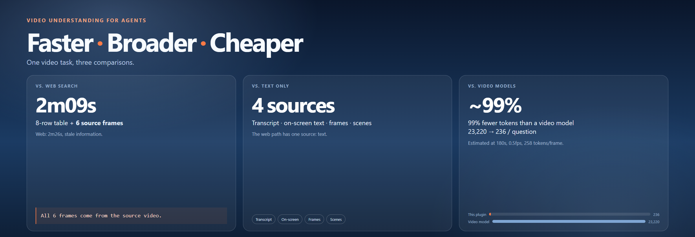
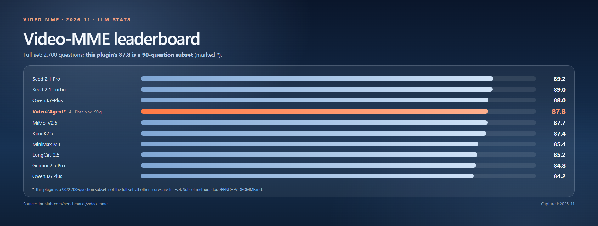
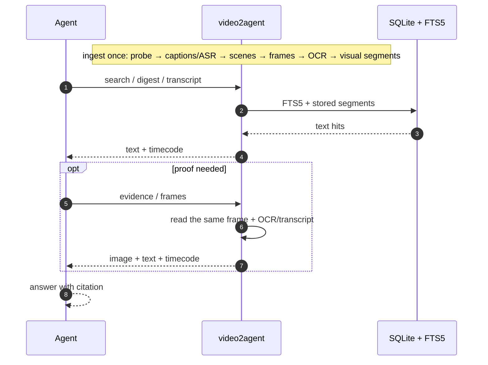

<p align="right">
  <b>English</b> · <a href="README.md">简体中文</a>
</p>

<p align="center">
  
</p>

<p align="center">
  <a href="https://github.com/Harm0ny-AI/DSH-Video2Agent/actions/workflows/ci.yml"></a>
  <a href="LICENSE"></a>
  
  <a href="https://github.com/topics/dsh-plugin"></a>
  
</p>

<h1 align="center">Your agent has read the web<br>Now let it watch the video</h1>

<p align="center">
  <b>Video2Agent lets an AI agent understand video and answer directly.</b><br>
  Ask Bilibili and local videos: what happens, which one is better, is it worth watching.
</p>

<p align="center"><sub>Local-first · optional cloud ASR/OCR (any OpenAI-compatible provider) · Bilibili QR login unlocks CC/AI subtitles</sub></p>

<p align="center">
  <a href="#faster-broader-cheaper">Benchmarks</a> ·
  <a href="#quick-start">Quick start</a> ·
  <a href="#what-it-does">What it does</a> ·
  <a href="#how-it-works">How it works</a> ·
  <a href="#docs">Docs</a> ·
  <a href="#marketplace">Marketplace</a>
</p>

<p align="center">
  
  <br>
  <sub>Real recording; waiting sections compressed.</sub>
</p>

<p align="center"><sub><b>1 Find</b> → <b>2 Process</b> → <b>3 Answer</b></sub></p>

---

## Faster, broader, cheaper

One video: **2m09s** to produce an 8-row cheat sheet + 6 source frames; the web path takes **2m26s**. **4** source types vs **1** for text-only, and **~99%** fewer tokens than a video model.



## Video-MME leaderboard

On the [llm-stats](https://llm-stats.com/benchmarks/video-mme) Video-MME board (2026-11, 2,700 questions), the orange row is **Video2Agent\* 87.8** (4.1 Flash Max), alongside frontier models; \* marks a [90-question subset](docs/BENCH-VIDEOMME.md).



## What it does

### 1. Find videos

Search Bilibili by keyword, filter by uploader or date, or paste a BV, av or b23 link to check the
title, cover and duration before processing.

### 2. Process videos in batches

Process local files or links: read the video's metadata, use CC/AI captions or ASR, detect scenes,
sample key frames, run OCR, then store the transcript, on-screen text, scenes and key frames locally.
Process 1–10 videos per batch; ask questions, compare videos and organize what you find, even on long
videos.

### 3. Understand the whole video

The plugin returns more than a transcript: transcript, on-screen text, scene structure, key frames and
motion. An agent can use that to answer questions, compare several videos, or turn the content into
steps, conclusions and usable advice.

- **Long films and courses**: see the structure and key content first, then decide what to dig into,
  without watching end to end.
- **UI motion and screen recordings**: read cuts, motion and interface changes to help developers
  trace interaction, animation and implementation issues.
- **Tutorials, reviews and interviews**: pull out steps, parameters, opinions and conclusions, and
  compare several videos together.

### 4. Manage Bilibili favorites

After QR login, browse favorites, history and folders; see duration, uploader and unfinished counts;
generate a classification draft grouped by uploader. The DSH `account` tool is read-only; folder edits
and batch classification stay in the CLI behind `--confirm`, and cookies stay local.

## Local, cloud and accounts

- **Local by default.** Transcription prefers the video's own captions (CC/AI) and only falls back to local Whisper when there are none. The ASR model is **not bundled and never downloaded automatically** — fetch it with `video2agent models download` (small ≈464 MB) or connect a cloud ASR provider in settings. On-screen text (RapidOCR), scene split and frame sampling run locally; video files never leave the machine, and no GPU or API key is required.
- **Cloud is optional.** The settings page can connect any OpenAI-compatible ASR/OCR provider (a default one with free quota is built in): transcription uploads audio only, and cloud OCR reads only the frames you explicitly ask about — a batch of sampled frames is never sent to a paid image model. The key is encrypted with Windows DPAPI on your machine and never appears in config, argv, logs or route responses.
- **Bilibili login is optional.** After QR login you get CC/AI subtitles (anonymous requests cannot list them), candidate search with uploader/date filters, and read access to favorites, history and folders plus a classification draft. Cookies stay in `~/.video2agent/cookies/`; the `account` tool is read-only and folder writes require `--confirm` on the CLI.
## Quick start

**Requirements:** Python 3.11+, FFmpeg on `PATH`, and DSH for the plugin surface.
The marketplace install is only the DSH integration layer; video work needs the CLI and FFmpeg. After installing, the plugin settings page has an environment check with one-click installs (CLI via pip, FFmpeg via winget/brew); or do it manually: `pip install video2agent`. Missing FFmpeg? `winget install Gyan.FFmpeg` (Windows), `brew install ffmpeg` (macOS), `apt install ffmpeg` (Linux), or point `FFMPEG_BIN` at an existing binary.
A speech model is only needed when a video has no captions (about 464 MB for `small`).

Published on PyPI and npm — install directly:

```bash
pip install video2agent
dsh plugin --profile web add dsh-video2agent
```

Use the clone route below for source or development.
```bash
git clone https://github.com/Harm0ny-AI/DSH-Video2Agent.git
cd DSH-Video2Agent

python -m venv .venv
# Windows: .venv\Scripts\activate    macOS/Linux: source .venv/bin/activate
pip install -e .

video2agent setup          # install the Skill into ~/.dsh/skills
video2agent doctor
video2agent ingest ./your-video.mp4      # or a Bilibili URL
video2agent list
video2agent search "what you remember"
```

Install the DSH plugin from this checkout:

```bash
dsh plugin --profile web add ./packages/dsh-video2agent
```

Then restart or reload DSH. The plugin registers a `video2agent` tool and a `/video` command; the
Skill installed by `video2agent setup` teaches the model the tool order and citation rules.

## How it works



**Design rules**

- **Text first, pixels on request.** Search returns text. `evidence` returns an image only when a
  quote needs checking, and the image and words are filtered to the same frame.
- **One boundary rule, no fake zero.** A timestamp past the media end is an error with a remedy; a
  failed OCR read is “unknown”, not “no text”; unread OCR stays `pending`/`partial`/`failed`, never 0.
- **Local-first, not air-gapped.** Local ASR/OCR runs on this machine; `evidence` frames and text
  are sent to the host model, so a cloud host model sees them. Cloud ASR/OCR is opt-in per section
  and uses your provider key; the settings page says what leaves the machine.
- **Bounded context.** Compact digest/transcript formats, image budgets, and cached reads keep a long
  investigation from turning into a context dump.

## Screenshots

| DSH plugin | Batch table | Settings |
|---|---|---|
|  |  |  |

The dark social card and marketplace card live in [`docs/assets/`](docs/assets).

## Docs

- [Architecture and invariants](docs/ARCHITECTURE.md)
- [Benchmark method and per-task results](docs/BENCH-VIDEOMME.md)
- [Limits and known failure modes](docs/LIMITS.md)
- [Plugin benchmark: routes, latency, polling](docs/PLUGIN-BENCH.md)
- [Long-video runs](docs/LONG-VIDEO-BENCH.md)
- [Bilibili subtitles and login](docs/BILIBILI-SUBTITLES.md)
- [CLI command reference](docs/ARCHITECTURE.md) · `video2agent --help`

## Status

- **0.1.7 released (2026-11-17).** CLI, Skill and the DSH plugin are available; install from PyPI or npm. 0.1.3 compacts the settings-page environment check into one status row (install buttons only for what is missing), makes `perceive` and `video2agent doctor` honour `FFMPEG_BIN`/`FFPROBE_BIN` like the media paths, and ships the real install steps on the plugin page. 0.1.2 added the environment check with one-click installs; 0.1.1 fixed reading to the end (no more E_OUT_OF_RANGE), bare millisecond values, Chinese audio mis-detected as Japanese, a misplaced batch progress ring, and an over-long single wait.
- Local-first by default; no GPU required. Cloud is optional.
- Published on PyPI and npm (`pip install video2agent`, `npm i dsh-video2agent`); the marketplace entry is prepared in the awesome-list format.
- Known limits: single-character CJK search, OCR on tiny/low-contrast text, counting across shots.

## Marketplace

Native DSH plugin (`dsh.bundle` → `cordis.patch.yml`), prepared for the
[awesome-dsh-plugin](https://github.com/awesome-dsh-plugin/awesome-dsh-plugin) list.

- Category: `vision`
- Install surface: `video2agent` tool + `/video` command; the CLI is the shared engine.

## Contributing

Issues and PRs are welcome. Start with `CONTRIBUTING.md`; for a code change, run:

```bash
python -m unittest discover -s tests -q
ruff check src tests --select E,F,I --ignore E501
node tests/test_plugin_card.mjs
node tests/test_plugin_manifest.mjs
node tests/test_plugin_host_settings.mjs
node tests/test_plugin_campaign.mjs
node tests/test_plugin_dock_state.mjs
```

## Usage and content rights

This is a local tool: it does not host, cache or distribute any video content, and it does not provide a public download service. Process only content you have the right to access and use. Downloading videos through platform links and storing transcripts or frames may be subject to platform terms and copyright law; lawful use of that material is the user's responsibility. Do not use it for bulk scraping, mirrored redistribution or commercial redistribution. Report infringement or abuse privately via `SECURITY.md`.
## License

Apache-2.0. Third-party notices are in [THIRD_PARTY_LICENSES.md](THIRD_PARTY_LICENSES.md).

<p align="center"><sub>If this saves you from scrubbing one more timeline, a ⭐ helps other agents find it.</sub></p>