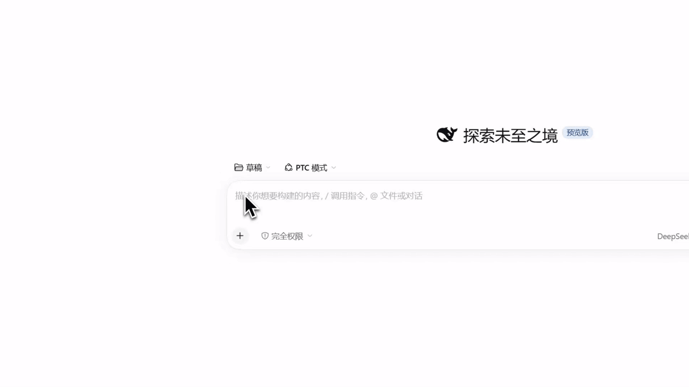
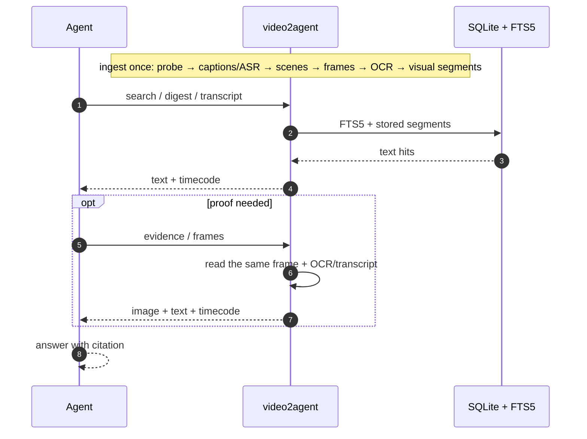
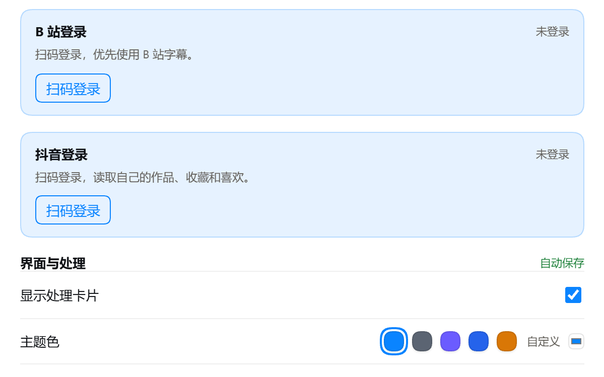

<p align="right">
  <b>English</b> · <a href="README.md">简体中文</a>
</p>

<p align="center">
  
</p>

<p align="center">
  <a href="https://github.com/Harm0ny-AI/DSH-Video2Agent/actions/workflows/ci.yml"></a>
  <a href="LICENSE"></a>
  
  <a href="https://github.com/topics/dsh-plugin"></a>
  
</p>

<h1 align="center">Bilibili/Douyin favorites gathering dust?<br>Give your agent video retrieval and understanding.</h1>

<p align="center">
  Bilibili/Douyin favorites gathering dust? Want your agent to gain video retrieval and understanding? Choose Video2Agent! One-click install gives your agent top-tier video understanding and turns online video into an information source. Whether you are researching social trends or working in media, any task that requires watching videos can now be handed to Video2Agent. Local-first; optional cloud ASR/OCR; optional Bilibili/Douyin login to unlock favorites/history and CC/AI subtitles.
</p>

<p align="center">
  <a href="#favorites-shouldnt-be-where-videos-go-to-die">Favorites</a> ·
  <a href="#faster-broader-cheaper">Benchmarks</a> ·
  <a href="#quick-start">Quick start</a> ·
  <a href="#what-it-does">What it does</a> ·
  <a href="#how-it-works">How it works</a> ·
  <a href="#docs">Docs</a> ·
  <a href="#marketplace">Marketplace</a>
</p>

<p align="center">
  
  <br>
  <sub>Real recording; waiting sections compressed.</sub>
</p>

<p align="center"><sub><b>1 Paste</b> → <b>2 Process</b> → <b>3 Ask</b></sub></p>

---

## Favorites shouldn’t be where videos go to die

Saved videos across Bilibili and Douyin are where good videos pile up and never get watched: saved because they looked useful, then lost, unfinished, forgotten.

Stop letting good videos gather dust! Video2Agent reads the video first—transcript, on-screen text, scenes, key frames—into your own local knowledge base. Then all you do is ask:

- **“What does this one actually say?”** → a few minutes of reading, with timecodes;
- **“What was that table at 12:00?”** → the source frame plus the text on that same frame;
- **“Which of these is the most complete?”** → compare 1–10 videos, with agreements and conflicts.

Keep saving. Let it do the reading.

---

## Faster, broader, cheaper

One video: **2m09s** to produce an 8-row cheat sheet + 6 source frames; the web path takes **2m26s**. **4** source types vs **1** for text-only, and **~99%** fewer tokens than a video model.


## Video-MME leaderboard

On the [llm-stats](https://llm-stats.com/benchmarks/video-mme) Video-MME board (2026-11, 2,700 questions), the orange row is **Video2Agent\* 87.8** (4.1 Flash Max), alongside frontier models; \* marks a [90-question subset](docs/BENCH-VIDEOMME.md).


## What it does

### 1. Turn favorites into a knowledge base

After Bilibili QR login your agent can read your favorites, history and folders (read-only), see duration, uploader and watch progress, then hand 1–10 videos over for processing. Douyin login reads your own works, favorites and liked videos—from the CLI or from any DSH session. Every processed video lands in a local library: transcript, on-screen text, scenes, key frames—searchable and askable later.

- **Read, don’t edit**: the DSH `account` tool never changes your favorites; folder edits and batch classification stay in the CLI behind `--confirm`.
- **Douyin lists can be risk-blocked**: the tool returns `unavailable` with a reason instead of calling an unreadable list “empty”.

### 2. A video source for your agent

The same library is an agent’s video source: the `video2agent` tool plus `/video` lets an agent check the video library before answering and cite exact timecodes and frames. Search Bilibili by keyword, uploader or date; Douyin links and local files share the same index—index once, then search, compare and organize from that library. You ask about your favorites; the agent answers with evidence you can trace back to the source frame.

Douyin search needs a saved login; `find` searches Bilibili + Douyin by default and `scope` restricts it.

### 3. Ask one video anything

Paste a Bilibili or Douyin link, or a local file; check the title, cover and duration before processing. Then ask what it says, whether it is worth watching, which minute holds the conclusion, or what that table on screen actually says. Answers carry timecodes; when you need proof, it returns the source frame and the text on that same frame.

Douyin risk-gates anonymous requests: a share page can answer with a verification page. The tool says it was blocked and suggests a retry instead of pretending the video has no content.

### 4. Compare a batch and skip what isn’t worth it

Process 1–10 videos and compare tutorials, reviews or interviews: which one is most complete, where they disagree, which one you can skip. Long videos do not need a full watch—see the structure and key content first, then decide where to dig in.

- **Long films and courses**: see structure and key content first;
- **UI motion and screen recordings**: read cuts, motion and interface changes;
- **Tutorials, reviews and interviews**: pull out steps, parameters, opinions and conclusions.

### 5. Accurate to the frame, honest about gaps

- **Captions are checked**: Bilibili AI captions are generated from the audio and used directly; human/community captions are compared with two audio windows and fall back to ASR on a mismatch.
- **Image and text share a frame**: every cited frame comes with the text on that exact frame and a timecode back to the source.
- **Unknown stays unknown**: unread OCR, failed reads and out-of-range timecodes are reported, never turned into a fake zero.
- **Local-first**: transcription, frame sampling and OCR run on your machine by default; cloud ASR/OCR is optional and only uploads what you explicitly ask for.

## Local, cloud and accounts

- **Local by default.** Transcription prefers the video's own captions (CC/AI) and only falls back to local Whisper when there are none. The ASR model is **not bundled and never downloaded automatically** — fetch it with `video2agent models download` (small ≈464 MB) or connect a cloud ASR provider in settings. On-screen text (RapidOCR), scene split and frame sampling run locally; video files never leave the machine, and no GPU or API key is required.
- **Cloud is optional.** The settings page can connect any OpenAI-compatible ASR/OCR provider (a default one with free quota is built in): transcription uploads audio only, and cloud OCR reads only the frames you explicitly ask about — a batch of sampled frames is never sent to a paid image model. The key is encrypted with Windows DPAPI on your machine and never appears in config, argv, logs or route responses.
- **Bilibili login is optional.** After QR login you get CC/AI subtitles (anonymous requests cannot list them), candidate search with uploader/date filters, and read access to favorites, history and folders plus a classification draft. Cookies stay in `~/.video2agent/cookies/`; the `account` tool is read-only and folder writes require `--confirm` on the CLI.
- **Douyin login is optional.** The settings environment check can install the browser component in one click; manually, `pip install "video2agent[browser]"`. `video2agent douyin login` then opens a login window for the scan and security check (settings only shows status), stores the session and closes automatically; `douyin profile --url <profile>` / `me` reads profile data, and `douyin videos --url <profile> --tab works|likes|favorites` lists works, favorites and liked videos. It drives the installed Chrome/Edge through Playwright; no browser is bundled.

## Quick start

**Requirements:** Python 3.11+, FFmpeg on `PATH`, and DSH for the plugin surface.
The marketplace install is only the DSH integration layer; video work needs the CLI, FFmpeg, and optionally the browser component/OCR. After installing, the plugin settings page has an environment check with per-item installs and a single "install missing" action (CLI, FFmpeg, browser component, OCR); or do it manually: `pip install video2agent`. Missing FFmpeg? `winget install Gyan.FFmpeg` (Windows), `brew install ffmpeg` (macOS), `apt install ffmpeg` (Linux), or point `FFMPEG_BIN` at an existing binary.
A speech model is only needed when a video has no captions (about 464 MB for `small`).
Local on-screen-text OCR is an optional extra: `pip install "video2agent[ocr]"` (Python 3.11/3.12). Core search/transcription/evidence and cloud OCR work without it.

Install directly:

```bash
pip install video2agent
dsh plugin --profile web add dsh-video2agent
```

To try 0.3.2 now, or to work on the source, use the clone route below.
```bash
git clone https://github.com/Harm0ny-AI/DSH-Video2Agent.git
cd DSH-Video2Agent

python -m venv .venv
# Windows: .venv\Scripts\activate    macOS/Linux: source .venv/bin/activate
pip install -e .

video2agent setup          # install the Skill into ~/.dsh/skills
video2agent doctor
video2agent ingest ./your-video.mp4      # or a Bilibili / Douyin URL
video2agent list
video2agent search "what you remember"
```

Install the DSH plugin from this checkout:

```bash
dsh plugin --profile web add ./packages/dsh-video2agent
```

Then restart or reload DSH. The plugin registers a `video2agent` tool and a `/video` command; the
Skill installed by `video2agent setup` teaches the model the tool order and citation rules.

## How it works



**Design rules**

- **Text first, pixels on request.** Search returns text. `evidence` returns an image only when a
  quote needs checking, and the image and words are filtered to the same frame.
- **One boundary rule, no fake zero.** A timestamp past the media end is an error with a remedy; a
  failed OCR read is “unknown”, not “no text”; unread OCR stays `pending`/`partial`/`failed`, never 0.
- **Local-first, not air-gapped.** Local ASR/OCR runs on this machine; `evidence` frames and text
  are sent to the host model, so a cloud host model sees them. Cloud ASR/OCR is opt-in per section
  and uses your provider key; the settings page says what leaves the machine.
- **Bounded context.** Compact digest/transcript formats, image budgets, and cached reads keep a long
  investigation from turning into a context dump.

## Screenshots

**Detailed analysis of a single video**


**Bilibili / Douyin login**



The dark social card and marketplace card live in [`docs/assets/`](docs/assets).

## Docs

- [Architecture and invariants](docs/ARCHITECTURE.md)
- [Benchmark method and per-task results](docs/BENCH-VIDEOMME.md)
- [Limits and known failure modes](docs/LIMITS.md)
- [Plugin benchmark: routes, latency, polling](docs/PLUGIN-BENCH.md)
- [Long-video runs](docs/LONG-VIDEO-BENCH.md)
- [Bilibili subtitles and login](docs/BILIBILI-SUBTITLES.md)
- [CLI command reference](docs/ARCHITECTURE.md) · `video2agent --help`

## Marketplace

Native DSH plugin (`dsh.bundle` → `cordis.patch.yml`), prepared for the
[awesome-dsh-plugin](https://github.com/awesome-dsh-plugin/awesome-dsh-plugin) list.

- Category: `vision`
- Install surface: `video2agent` tool + `/video` command; the CLI is the shared engine.

## Contributing

Issues and PRs are welcome. Start with `CONTRIBUTING.md`; for a code change, run:

```bash
python -m unittest discover -s tests -q
ruff check src tests --select E,F,I --ignore E501
node tests/test_plugin_card.mjs
node tests/test_plugin_manifest.mjs
node tests/test_plugin_host_settings.mjs
node tests/test_plugin_campaign.mjs
node tests/test_plugin_dock_state.mjs
```

## License

Apache-2.0. Third-party notices are in [THIRD_PARTY_LICENSES.md](THIRD_PARTY_LICENSES.md).

<p align="center"><sub>If this saves you from scrubbing one more timeline, a ⭐ helps other agents find it.</sub></p>