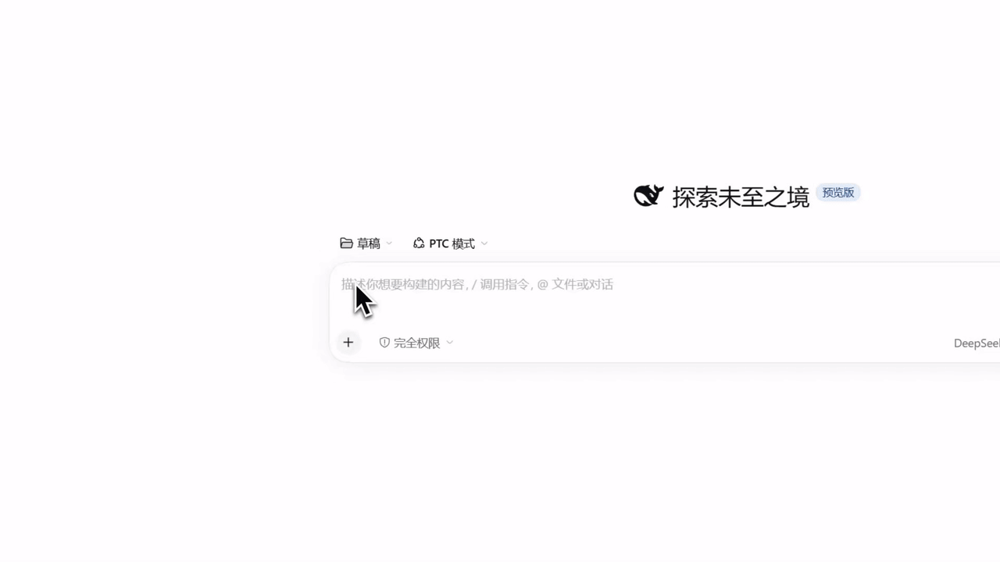
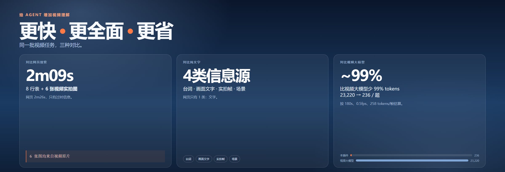
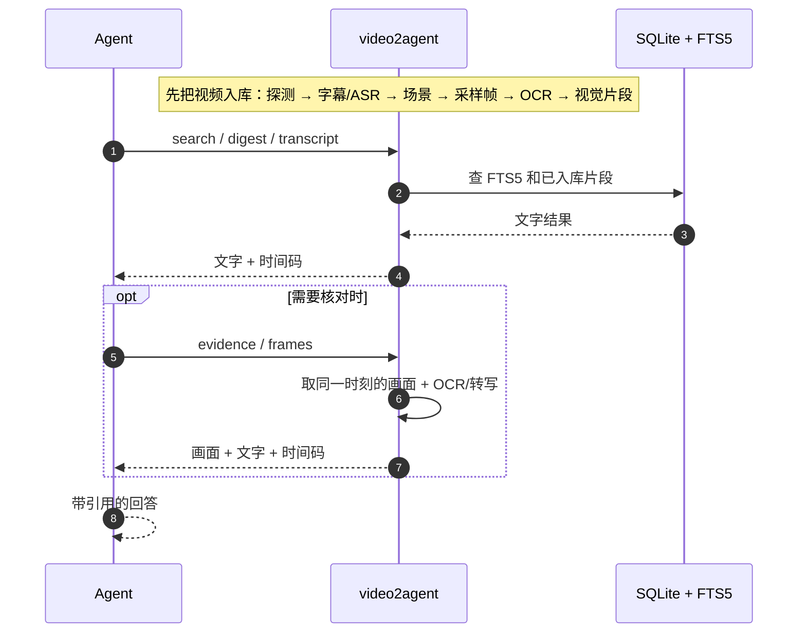

<p align="right">
  <a href="README.en.md">English</a> · <b>简体中文</b>
</p>

<p align="center">
  
</p>

<p align="center">
  <a href="https://github.com/Harm0ny-AI/DSH-Video2Agent/actions/workflows/ci.yml"></a>
  <a href="LICENSE"></a>
  
  <a href="https://github.com/topics/dsh-plugin"></a>
  
</p>

<h1 align="center">B站/抖音收藏夹吃灰？<br>让 Agent 拥有视频检索和理解能力。</h1>

<p align="center">
  B站/抖音收藏夹吃灰？想要Agent获得视频检索和理解能力？欢迎选择Video2Agent！一键安装，让Agent获取顶尖视频理解能力，并获取网络视频作为信息源。无论你是想调研社会趋势，还是自媒体工作者，只要需要你看视频完成的工作，现在统统交给Video2Agent即可！本地优先，云端 ASR/OCR 可选；B 站/抖音登录可选，解锁收藏夹/历史与 CC/AI 字幕。
</p>

<p align="center">
  <a href="#收藏夹不该是视频的终点">收藏夹</a> ·
  <a href="#更快更全面更省">实测</a> ·
  <a href="#快速开始">快速开始</a> ·
  <a href="#它能做什么">它能做什么</a> ·
  <a href="#工作原理">工作原理</a> ·
  <a href="#文档">文档</a> ·
  <a href="#插件市场">插件市场</a>
</p>

<p align="center">
  
  <br>
  <sub>实录；等待部分已压缩。</sub>
</p>

<p align="center"><sub><b>1 贴链接</b> → <b>2 处理</b> → <b>3 提问</b></sub></p>

---

## 收藏夹不该是视频的终点

B 站收藏夹、抖音收藏和喜欢，是很多人最大的“待看清单”，也最容易吃灰：收藏时觉得有用，真要看时找不到、看不完、记不住。

别再让好视频烂在收藏夹里！Video2Agent 先把视频读一遍——转写、画面上的字、场景、关键画面——存成你自己的本地知识库。然后你只负责问：

- **“这条到底讲了什么？”** → 几分钟读完，带时间码；
- **“第 12 分钟那张表写了什么？”** → 原帧 + 同一帧上的文字，不靠猜；
- **“这几条哪条讲得最全？”** → 1–10 条批量对比，共识和分歧都列出来。

收藏照旧，读的事交给它。

---

## 更快、更全面、更省

一条视频：**2m09s** 做出 8 行速查表 + 6 张原片截图；走网页要 **2m26s**。信息源 **4 类**，纯文字只有 **1 类**；比视频大模型少 **~99%** tokens。



## Video-MME 排行

在 [llm-stats](https://llm-stats.com/benchmarks/video-mme) 2026-11 的 Video-MME 全量榜（2,700 题）上，橙色那行是 **Video2Agent\* 87.8**（4.1 Flash Max），与前沿模型同榜；\* 表示 [90 题子集](docs/BENCH-VIDEOMME.md)。


## 它能做什么

### 1. 把收藏夹变成知识库

B 站扫码登录后，Agent 能读你的收藏夹、历史、文件夹（只读），看到时长、UP 主和看完进度；挑几条交给它，1–10 条一起处理。抖音登录后也能读自己的作品、收藏和喜欢列表——命令行和 DSH 里的 Agent 都能读。处理完的视频进本地库：转写、画面文字、场景、关键帧，之后随时搜、随时问。

- **只看不改**：DSH 里的 `account` 工具不改你的收藏夹；要整理文件夹、批量分类，回 CLI 加 `--confirm`。
- **抖音列表可能被风控**：会如实返回 `unavailable` 和原因，不会把“读不到”说成“没有视频”。

### 2. 给 Agent 的视频信息源

同一份视频库，也是 Agent 的信息源：`video2agent` 工具 + `/video` 命令，让 Agent 回答前先查视频库，引用具体时间码和画面。B 站按关键词、UP 主、发布时间找片；抖音链接、本地文件走同一套索引；一次入库，之后搜索、对比、整理都直接查这份内容。你问的是收藏夹，Agent 拿到的是能回原片核对的证据。

抖音搜索默认关闭；`find` 默认只搜 B 站，只有用户明确指定抖音平台，或开启设置里的「抖音搜索」后才搜索。开启后遇到验证，需要你在 Chrome 窗口完成。

### 3. 一条视频，问到底

贴 B 站/抖音链接或本地文件，先看标题、封面、时长，再决定要不要处理。处理完可以问：讲了什么、值不值得看、结论在第几分钟、画面里那张表写了什么。答案带时间码；需要核对时，取回同一时刻的原帧和文字。

抖音网页有风控，匿名分享页可能返回验证页：会明确说被拦了并建议重试，不会把失败伪装成“没有内容”。

### 4. 批量对比，挑出真正值得看的

一次处理 1–10 条视频，横向对比教程、评测、访谈：哪条讲得全、哪里互相矛盾、哪条可以跳过。长视频不用整段重看，先看结构和关键内容，再决定深入哪一段。

- **长电影、长课程**：先看结构和关键内容，再决定要不要深入；
- **UI 动效、操作录屏**：看切镜、运动和界面变化，帮开发定位交互和实现问题；
- **教程、评测、访谈**：把步骤、参数、观点和结论抽出来，多条视频放在一起对比。

### 5. 准确到帧，不装懂

- **字幕会核对**：B 站 AI 字幕按音频生成，直接用；人工/社区字幕会抽两段音频比对，可疑就回退 ASR，不拿错字幕糊弄你。
- **图文同帧**：引用画面时，图和文字一定来自同一帧，时间码可回原片。
- **不知道就说不知道**：OCR 没读、读取失败、时间码越界都会明确说明，不会写成“没有”。
- **本地优先**：转写、抽帧、OCR 默认在本机跑；云端 ASR/OCR 可选，只上传你点名要处理的内容。

## 本地、云端与账号

- **默认全本地。** 转写优先用视频自带字幕（CC/AI），没有字幕时才走本地 Whisper；ASR 模型**不随包分发、也不会自动下载**，需要时用 `video2agent models download`（`small` 约 464 MB）或在设置里连接云端 ASR。画面文字（RapidOCR）、场景切分和抽帧都在本机跑，视频文件不出机器；不需要 GPU，不需要 API Key。
- **云端可选。** 设置页可以接入任意 OpenAI 兼容的 ASR/OCR 服务商（内置默认服务商，有免费额度）：转写只上传音频，云端 OCR 只读你点名时刻的画帧，不会把整批抽帧发给付费图像模型。Key 用 Windows DPAPI 加密存在本机，不写进配置、argv、日志或接口响应。
- **B 站登录可选。** 扫码登录后解锁 CC/AI 字幕（匿名请求拿不到字幕列表）、按 UP 主/发布时间筛选候选，以及收藏夹、历史、文件夹的读取与分类草案。Cookie 只留在 `~/.video2agent/cookies/`；`account` 工具只读，改文件夹/批量分类要回 CLI 加 `--confirm`。
- **抖音登录可选。** 设置页「环境检查」可一键安装 Playwright；也可手动 `pip install "video2agent[browser]"`。之后 `video2agent douyin login` 会打开一个登录窗口用于扫码和安全验证（设置页只显示登录状态，不显示二维码），确认后窗口自动关闭并保存登录状态；`douyin profile --url <主页>` / `me` 读主页资料，`douyin videos --url <主页> --tab works|likes|favorites` 读作品/收藏/喜欢列表。用 Playwright 驱动本机 Chrome/Edge，不内置浏览器。

## 快速开始

**环境：** Python 3.11+、FFmpeg（在 `PATH` 中），以及 DSH（用插件界面时需要）。
从插件市场安装的只是 DSH 集成层：实际处理视频还需要 CLI、FFmpeg 以及可选的 Playwright/OCR。安装后打开插件设置页的「环境检查」，缺什么可以逐项安装，也可以点「一键安装缺少项」（CLI、FFmpeg、Playwright、OCR）；也可以手动 `pip install video2agent`（FFmpeg 缺失时先 `winget install Gyan.FFmpeg` / `brew install ffmpeg` / `apt install ffmpeg`，或设置 `FFMPEG_BIN`）。
视频没有字幕时，才需要语音模型（`small` 约 464 MB，**不会自动下载**，用 `video2agent models download` 显式安装）。
本地画面文字 OCR 是可选额外包：`pip install "video2agent[ocr]"`（需要 Python 3.11/3.12；核心检索/转写/取帧不需要它，云端 OCR 也不需要）。

各平台密钥存储：Windows 用 DPAPI，macOS 用登录钥匙串（Keychain），Linux 用 `$VIDEO2AGENT_HOME/secrets/cloud.key`（0600）；任何平台都可以改用 `SILICONFLOW_API_KEY` 环境变量。

直接安装：

```bash
pip install video2agent
dsh plugin --profile web add dsh-video2agent
```

想先试 0.3.3，或者参与开发，走下面的源码方式。
```bash
git clone https://github.com/Harm0ny-AI/DSH-Video2Agent.git
cd DSH-Video2Agent

python -m venv .venv
# Windows: .venv\Scripts\activate    macOS/Linux: source .venv/bin/activate
pip install -e .

video2agent setup          # 把 Skill 安装到 ~/.dsh/skills
video2agent doctor
video2agent ingest ./your-video.mp4      # 或 B 站 / 抖音链接
video2agent list
video2agent search "what you remember"
```

从当前仓库安装 DSH 插件：

```bash
dsh plugin --profile web add ./packages/dsh-video2agent
```

然后重启或重新加载 DSH。插件会注册 `video2agent` 工具和 `/video` 命令；`video2agent setup` 装好的 Skill 会告诉模型先调什么、引用怎么写。

## 工作原理



**设计规则**

- **先文字，后画面。** 搜索只返回文字；只有需要核对某句话时，`evidence` 才取图，而且图和文字一定来自同一帧。
- **边界明确，不把未知当零。** 时间码超过视频结尾，会直接报错并给出处理建议；OCR 读取失败就是“未知”，不是“没有文字”；没读过的 OCR 保持 `pending`/`partial`/`failed`，绝不写成 0。
- **默认本地处理，但不等于离线。** 本地 ASR/OCR 都在这台机器上跑；`evidence` 取到的画面和文字会交给宿主模型，所以用云端模型时，它们会离开本机。云端 ASR/OCR 可以单独开启，用你自己的服务商密钥；设置页会写清楚哪些内容会发出去。
- **上下文有上限。** `digest`/`transcript` 都是紧凑格式，图片有预算，读取有缓存，查得再久也不会把上下文塞满。

## 截图

**单条视频的详细分析**


**B 站 / 抖音登录**


深色社交分享图和插件市场卡片在 [`docs/assets/`](docs/assets)。

## 文档

- [架构与设计约束](docs/ARCHITECTURE.md)
- [基准方法与逐题结果](docs/BENCH-VIDEOMME.md)
- [限制与已知问题](docs/LIMITS.md)
- [插件基准：接口、延迟与轮询](docs/PLUGIN-BENCH.md)
- [长视频实测](docs/LONG-VIDEO-BENCH.md)
- [B 站字幕与登录](docs/BILIBILI-SUBTITLES.md)
- [CLI 命令参考](docs/ARCHITECTURE.md) · `video2agent --help`

## 插件市场

原生 DSH 插件（`dsh.bundle` → `cordis.patch.yml`），已经按 [awesome-dsh-plugin](https://github.com/awesome-dsh-plugin/awesome-dsh-plugin) 的格式准备好条目。

- 分类：`vision`
- 安装入口：`video2agent` 工具 + `/video` 命令；CLI 是同一套引擎。

## 参与贡献

欢迎提交 Issue 和 PR。先看 `CONTRIBUTING.md`；改代码后请运行：

```bash
python -m unittest discover -s tests -q
ruff check src tests --select E,F,I --ignore E501
node tests/test_plugin_card.mjs
node tests/test_plugin_manifest.mjs
node tests/test_plugin_host_settings.mjs
node tests/test_plugin_campaign.mjs
node tests/test_plugin_dock_state.mjs
```

## 许可证

Apache-2.0。第三方声明见 [THIRD_PARTY_LICENSES.md](THIRD_PARTY_LICENSES.md)。

<p align="center"><sub>如果它帮你少拖了一次进度条，点个 ⭐ 能让更多 Agent 找到它。</sub></p>