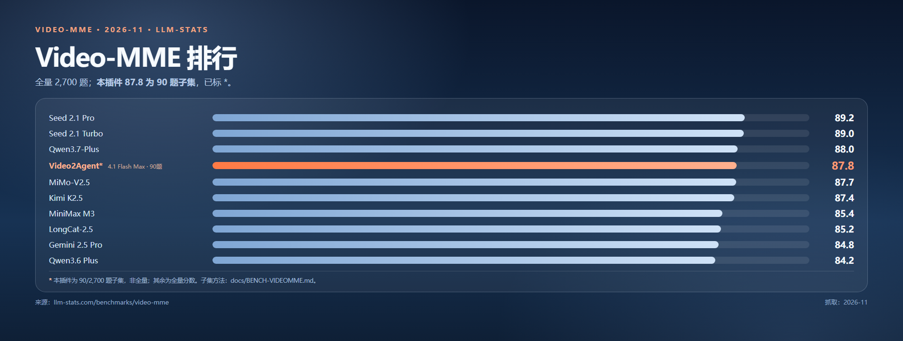
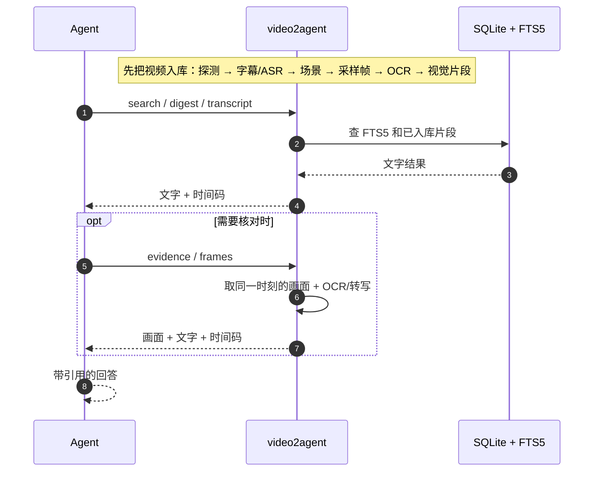
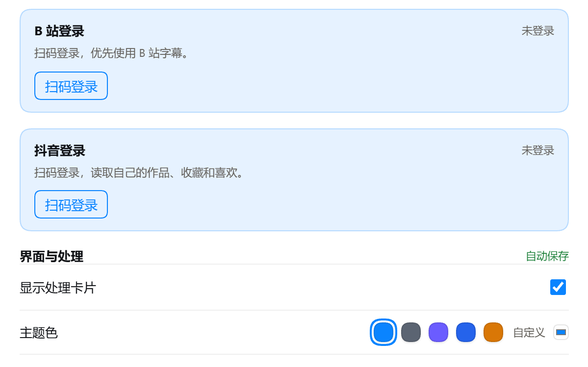

<p align="right">
  <a href="https://github.com/Harm0ny-AI/DSH-Video2Agent/blob/main/README.en.md">English</a> · <b>简体中文</b>
</p>

<p align="center">
  
</p>

<p align="center">
  <a href="https://github.com/Harm0ny-AI/DSH-Video2Agent/actions/workflows/ci.yml"></a>
  <a href="https://github.com/Harm0ny-AI/DSH-Video2Agent/blob/main/LICENSE"></a>
  
  <a href="https://github.com/topics/dsh-plugin"></a>
  
</p>

<h1 align="center">你的 Agent 浏览了无数网页<br>现在该让它看视频了</h1>

<p align="center">
  <b>Video2Agent 让 AI Agent 看懂视频、直接回答。</b><br>
  B 站和本地视频都能问：讲了什么、哪条更好、值不值得看。
</p>

<p align="center">
  <a href="#更快更全面更省">实测</a> ·
  <a href="#快速开始">快速开始</a> ·
  <a href="#它能做什么">它能做什么</a> ·
  <a href="#工作原理">工作原理</a> ·
  <a href="#文档">文档</a> ·
  <a href="#插件市场">插件市场</a>
</p>

<p align="center">
  
  <br>
  <sub>实录；等待部分已压缩。</sub>
</p>

<p align="center"><sub><b>1 找视频</b> → <b>2 处理</b> → <b>3 回答</b></sub></p>

---

## 更快、更全面、更省

一条视频：**2m09s** 做出 8 行速查表 + 6 张原片截图；走网页要 **2m26s**。信息源 **4 类**，纯文字只有 **1 类**；比视频大模型少 **~99%** tokens。


## Video-MME 排行

在 [llm-stats](https://llm-stats.com/benchmarks/video-mme) 2026-11 的 Video-MME 全量榜（2,700 题）上，橙色那行是 **Video2Agent\* 87.8**（4.1 Flash Max），与前沿模型同榜；\* 表示 [90 题子集](https://github.com/Harm0ny-AI/DSH-Video2Agent/blob/main/docs/BENCH-VIDEOMME.md)。



## 它能做什么

### 1. 检索网络视频

在 B 站按关键词找片，按 UP 主、发布时间筛选；也可以直接贴 BV、av 或 b23 链接，先看标题、封面、时长，再决定要不要处理。

### 2. 批量处理视频

本地文件或链接都能处理：先读视频信息，再走 CC/AI 字幕或 ASR，切镜头、抽取关键画面、做 OCR，最后把转写、画面文字、场景和关键画面存到本地。一次一批 1–10 条；之后问答、对比、整理都直接查这份内容，长视频也不用整段重看。

### 3. 获得全面视频理解

插件给出的不只是转写，而是转写、画面文字、场景结构、关键画面和运动信息。Agent 可以据此回答视频里的问题、比较多条视频，或者把内容整理成步骤、结论和可用的建议。

- **长电影、长课程**：先看结构和关键内容，再决定要不要深入，不用从头看到尾。
- **UI 动效、操作录屏**：看切镜、运动和界面变化，帮开发定位交互、动效和实现问题。
- **教程、评测、访谈**：把步骤、参数、观点和结论抽出来，多条视频放在一起对比。

### 4. 管理 B 站收藏夹

扫码登录后，能看收藏夹、历史、文件夹，统计时长、UP 主和未看完，按 UP 主生成分类草案。DSH 里的 `account` 工具只读；真正整理文件夹、批量分类，回 CLI 加 `--confirm` 才动手，Cookie 只留在本地。

## 快速开始

**环境：** Python 3.11+、FFmpeg（在 `PATH` 中），以及 DSH（用插件界面时需要）。
视频没有字幕时，才需要语音模型（`small` 约 464 MB）。

已发布到 PyPI 和 npm，可以直接安装：

```bash
pip install video2agent
dsh plugin --profile web add dsh-video2agent
```

想用源码或参与开发，走下面的克隆方式。
```bash
git clone https://github.com/Harm0ny-AI/DSH-Video2Agent.git
cd DSH-Video2Agent

python -m venv .venv
# Windows: .venv\Scripts\activate    macOS/Linux: source .venv/bin/activate
pip install -e .

video2agent setup          # 把 Skill 安装到 ~/.dsh/skills
video2agent doctor
video2agent ingest ./your-video.mp4      # 或 B 站链接
video2agent list
video2agent search "what you remember"
```

从当前仓库安装 DSH 插件：

```bash
dsh plugin --profile web add ./packages/dsh-video2agent
```

然后重启或重新加载 DSH。插件会注册 `video2agent` 工具和 `/video` 命令；`video2agent setup` 装好的 Skill 会告诉模型先调什么、引用怎么写。

## 工作原理



**设计规则**

- **先文字，后画面。** 搜索只返回文字；只有需要核对某句话时，`evidence` 才取图，而且图和文字一定来自同一帧。
- **边界明确，不把未知当零。** 时间码超过视频结尾，会直接报错并给出处理建议；OCR 读取失败就是“未知”，不是“没有文字”；没读过的 OCR 保持 `pending`/`partial`/`failed`，绝不写成 0。
- **默认本地处理，但不等于离线。** 本地 ASR/OCR 都在这台机器上跑；`evidence` 取到的画面和文字会交给宿主模型，所以用云端模型时，它们会离开本机。云端 ASR/OCR 可以单独开启，用你自己的服务商密钥；设置页会写清楚哪些内容会发出去。
- **上下文有上限。** `digest`/`transcript` 都是紧凑格式，图片有预算，读取有缓存，查得再久也不会把上下文塞满。

## 截图

| DSH 插件 | 批量任务 | 设置 |
|---|---|---|
|  |  |  |

深色社交分享图和插件市场卡片在 [`docs/assets/`](https://github.com/Harm0ny-AI/DSH-Video2Agent/tree/main/docs/assets)。

## 文档

- [架构与设计约束](https://github.com/Harm0ny-AI/DSH-Video2Agent/blob/main/docs/ARCHITECTURE.md)
- [基准方法与逐题结果](https://github.com/Harm0ny-AI/DSH-Video2Agent/blob/main/docs/BENCH-VIDEOMME.md)
- [限制与已知问题](https://github.com/Harm0ny-AI/DSH-Video2Agent/blob/main/docs/LIMITS.md)
- [插件基准：接口、延迟与轮询](https://github.com/Harm0ny-AI/DSH-Video2Agent/blob/main/docs/PLUGIN-BENCH.md)
- [长视频实测](https://github.com/Harm0ny-AI/DSH-Video2Agent/blob/main/docs/LONG-VIDEO-BENCH.md)
- [B 站字幕与登录](https://github.com/Harm0ny-AI/DSH-Video2Agent/blob/main/docs/BILIBILI-SUBTITLES.md)
- [CLI 命令参考](https://github.com/Harm0ny-AI/DSH-Video2Agent/blob/main/docs/ARCHITECTURE.md) · `video2agent --help`

## 状态

- **0.1.0 候选版。** CLI 和 Skill 已经稳定；DSH 插件也在隔离环境里验证过。
- 默认在本地跑，不需要 GPU；云端可选。
- 已发布到 PyPI 和 npm：`pip install video2agent`、`npm i dsh-video2agent`；插件市场条目已按 awesome 列表格式准备好。
- 已知限制：单字中文搜索、小字/低对比度文字的 OCR、跨镜头计数。

## 插件市场

原生 DSH 插件（`dsh.bundle` → `cordis.patch.yml`），已经按 [awesome-dsh-plugin](https://github.com/awesome-dsh-plugin/awesome-dsh-plugin) 的格式准备好条目。

- 分类：`vision`
- 安装入口：`video2agent` 工具 + `/video` 命令；CLI 是同一套引擎。

## 参与贡献

欢迎提交 Issue 和 PR。先看 `CONTRIBUTING.md`；改代码后请运行：

```bash
python -m unittest discover -s tests -q
ruff check src tests --select E,F,I --ignore E501
node tests/test_plugin_card.mjs
node tests/test_plugin_manifest.mjs
node tests/test_plugin_host_settings.mjs
node tests/test_plugin_campaign.mjs
node tests/test_plugin_dock_state.mjs
```

## 许可证

Apache-2.0。第三方声明见 [THIRD_PARTY_LICENSES.md](https://github.com/Harm0ny-AI/DSH-Video2Agent/blob/main/THIRD_PARTY_LICENSES.md)。

<p align="center"><sub>如果它帮你少拖了一次进度条，点个 ⭐ 能让更多 Agent 找到它。</sub></p>