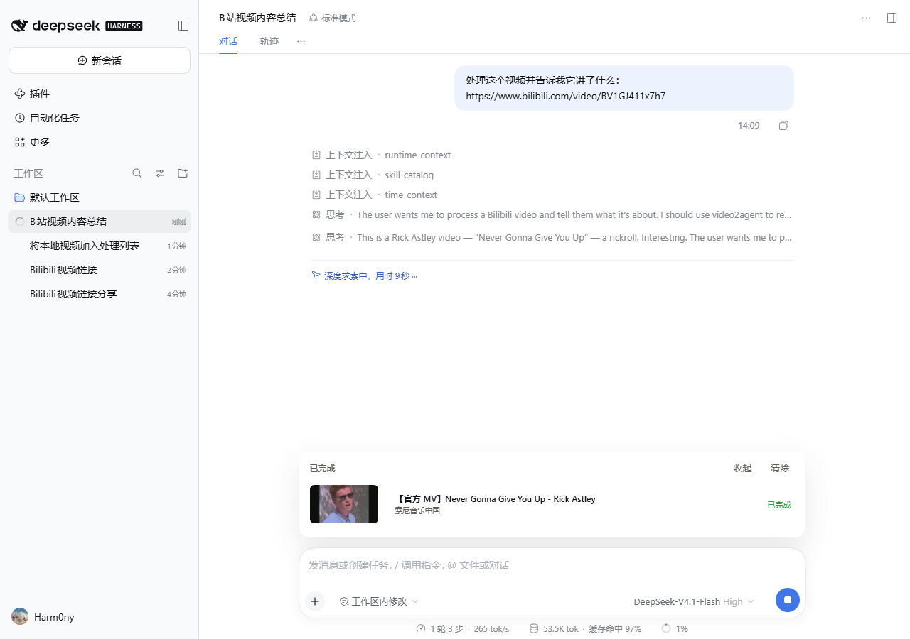

# dsh-video2agent

<h3 align="center">你的 Agent 浏览了无数网页<br>现在该让它看视频了</h3>

<p align="center"><b>Video2Agent 让 AI Agent 看懂视频、直接回答。</b><br>
B 站和本地视频都能问：讲了什么、哪条更好、值不值得看。</p>

<p align="center">
  
</p>

Video search and understanding for DSH. One library for local files and Bilibili links:
cross-video search with video + timecode, exact-frame evidence, and 1–10 video batch
analysis. Local-first; cloud ASR/OCR and Bilibili login are optional.

## What you can ask

- 「这期视频讲了什么？」→ 概要 + 时间码，想核对就点回原片；
- 「这几个速通视频哪条讲得更好/更全？」→ 1–10 个视频批量读完后对比共识与分歧；
- 「这个视频值不值得看？」→ 用转写、画面上的字（OCR）和关键帧回答，不靠标题；
- 「第 12 分钟那张表写了什么？」→ 按时间码取帧，配同一帧上的文字作证据。

## Install

```bash
# 1. The Python CLI (the plugin calls this executable)
pip install video2agent          # PyPI; pipx install video2agent also works
video2agent setup                # install the Skill into ~/.dsh/skills
video2agent doctor               # checks Python, FFmpeg and the Python packages

# 2. This plugin
dsh plugin --profile web add dsh-video2agent   # npm
```

Requires Python 3.11+ and FFmpeg. The plugin settings page has a one-click
**环境检查** (Python / CLI / FFmpeg) that reports what is missing and installs it
(CLI via pip, FFmpeg via winget/brew).

Local on-screen-text OCR is an optional extra: `pip install "video2agent[ocr]"`
(Python 3.11/3.12 — `rapidocr-onnxruntime` has no 3.13 wheel yet). Core search,
transcription and evidence work without it; cloud OCR does not need it. Any DSH 0.2.1 / 0.2.2 profile works; the host
command is optional, so headless/TUI profiles still get the tool and `/video`.

- PyPI: <https://pypi.org/project/video2agent/>
- npm: <https://www.npmjs.com/package/dsh-video2agent>
- Releases: <https://github.com/Harm0ny-AI/DSH-Video2Agent/releases>

## Screenshots

| 识别视频链接 | 批量处理 | 设置页 · 环境检查 |
|---|---|---|
|  |  |  |

## What it adds

- `video2agent` tool and `/video` command.
- Composer preview for `bilibili.com/video/BV…`, `av` numbers, `b23.tv` links and bare BV ids.
- A session-scoped selected-video table above the composer: cover, title, one plain-language status and stop.
- **Search across videos** (the default scope), **batch analysis** of 1–10 videos, and **evidence** frames with transcript/OCR from the same moment.
- Optional Bilibili QR login for discovery, favorites/history/folders and CC/AI subtitles. The DSH account tool is read-only; folder writes are CLI-only with `--confirm`.
- Local ASR/OCR runs on this machine; only the frames/text you ask for reach the host model. Cloud ASR/OCR is opt-in per section and uses the provider key you configure.

## Manifest

`package.json` declares:

```json
"dsh": { "bundle": { "patch": "./cordis.patch.yml" }, "client": { "platform": "web" } }
```

The host command is optional (`webServer` is injected, not required), so headless/TUI profiles still get the tool and `/video`.

## Documentation

- [Repository README](https://github.com/Harm0ny-AI/DSH-Video2Agent#readme)
- [Architecture](https://github.com/Harm0ny-AI/DSH-Video2Agent/blob/main/docs/ARCHITECTURE.md)
- [Benchmark and limits](https://github.com/Harm0ny-AI/DSH-Video2Agent/blob/main/docs/BENCH-VIDEOMME.md)
- [Security](https://github.com/Harm0ny-AI/DSH-Video2Agent/blob/main/SECURITY.md)

Apache-2.0.