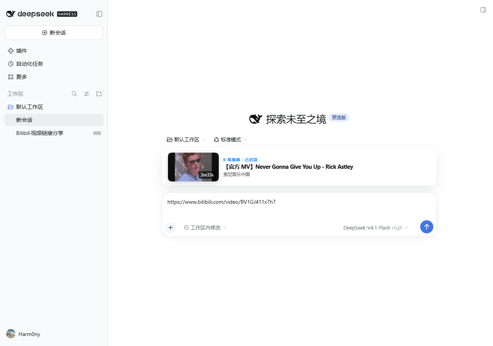

# dsh-video2agent

**Video search and understanding for DSH.** One library for local files and Bilibili links:
cross-video search with video + timecode, exact-frame evidence, and 1–10 video batch analysis.
Local-first; cloud ASR/OCR is optional.

<p align="center">
  
</p>

## Install

```bash
# 1. The Python CLI (the plugin calls this executable)
pip install video2agent          # PyPI; pipx install video2agent also works
video2agent setup                # install the Skill into ~/.dsh/skills
video2agent doctor               # checks Python, FFmpeg and the Python packages

# 2. This plugin
dsh plugin --profile web add dsh-video2agent   # npm
```

Requires Python 3.11+ and FFmpeg (or let the plugin install them: after installing,
open the plugin settings page — **环境检查** checks Python/CLI/FFmpeg and installs
what is missing with one click). Any DSH 0.2.1 / 0.2.2 profile works; the host command
is optional, so headless/TUI profiles still get the tool and `/video`.

- PyPI: <https://pypi.org/project/video2agent/>
- npm: <https://www.npmjs.com/package/dsh-video2agent>
- Releases: <https://github.com/Harm0ny-AI/DSH-Video2Agent/releases>

## What it adds

- `video2agent` tool and `/video` command.
- Composer preview for `bilibili.com/video/BV…`, `av` numbers, `b23.tv` links and bare BV ids.
- A session-scoped selected-video table above the composer: cover, title, uploader, duration, one plain-language stage and stop.
- **Search across videos** (`search` covers the library by default), **batch analysis** of 1–10 videos, and **evidence** frames with transcript/OCR from the same moment.
- Optional Bilibili QR login for discovery, favorites/history/folders and CC/AI subtitles. The DSH account tool is read-only; folder writes are CLI-only with `--confirm`.
- Local ASR/OCR runs on this machine; evidence frames/text go to the host model (a cloud host model sees them). Cloud ASR/OCR is opt-in per section and uses the provider key you configure.

## Screenshots

| Composer preview | Batch table | Settings |
|---|---|---|
|  |  |  |

More: [completed batch table](assets/screenshot-4.png) · [live ingest card](assets/screenshot-5.png).

## Manifest

`package.json` declares:

```json
"dsh": { "bundle": { "patch": "./cordis.patch.yml" }, "client": { "platform": "web" } }
```

The host command is optional (`webServer` is injected, not required), so headless/TUI profiles still get the tool and `/video`.

## Documentation

- [Repository README](https://github.com/Harm0ny-AI/DSH-Video2Agent#readme)
- [Architecture](https://github.com/Harm0ny-AI/DSH-Video2Agent/blob/main/docs/ARCHITECTURE.md)
- [Benchmark and limits](https://github.com/Harm0ny-AI/DSH-Video2Agent/blob/main/docs/BENCH-VIDEOMME.md)
- [Security](https://github.com/Harm0ny-AI/DSH-Video2Agent/blob/main/SECURITY.md)

Apache-2.0.