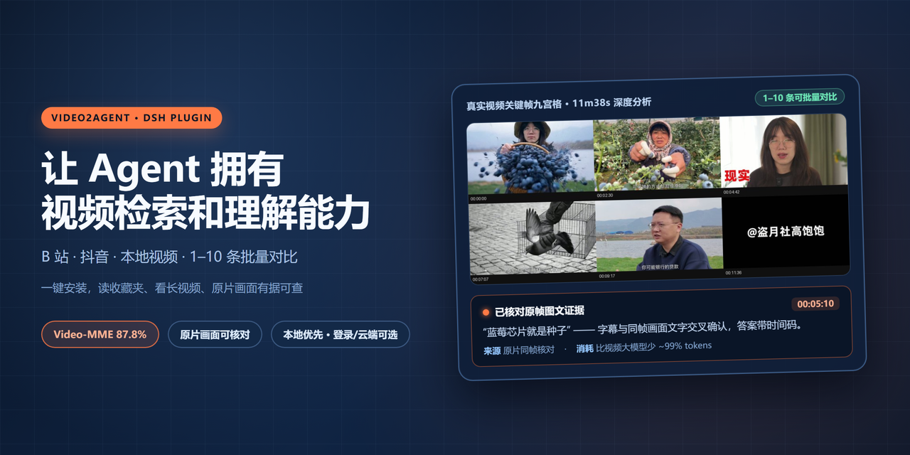
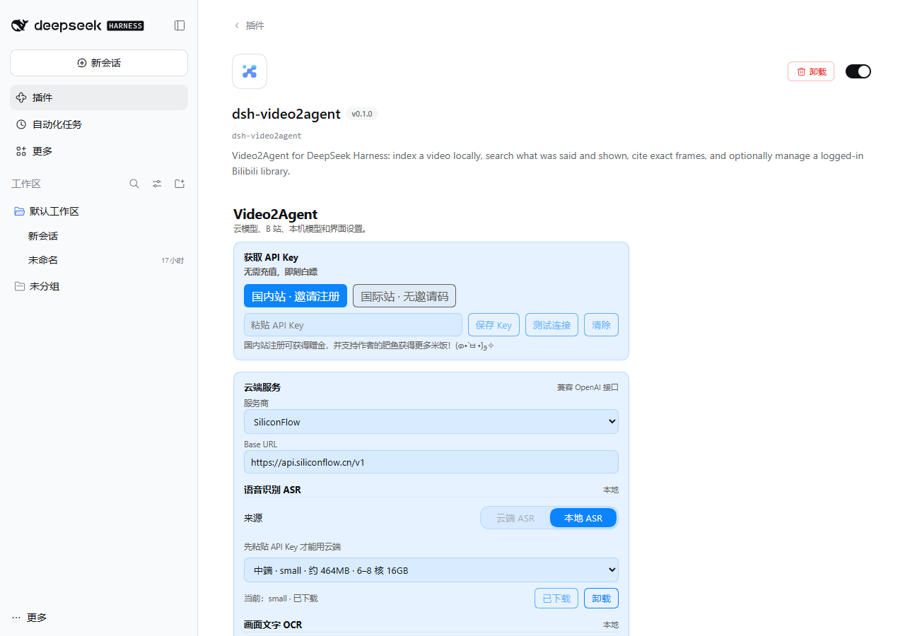
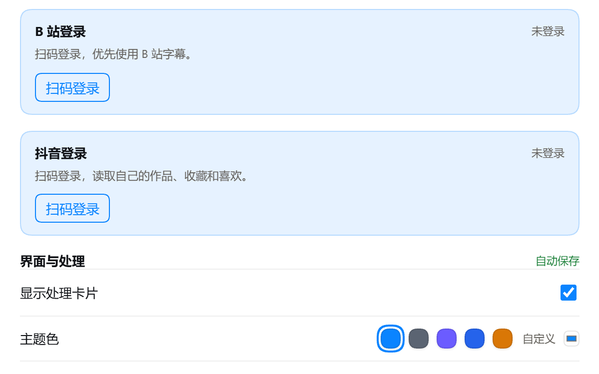

# dsh-video2agent

[English README on GitHub](https://github.com/Harm0ny-AI/DSH-Video2Agent/blob/main/README.en.md) · **简体中文**

**让 Agent 拥有视频检索和理解能力。**

想要Agent获得视频检索和理解能力？欢迎选择Video2Agent！一键安装，让Agent获取顶尖视频理解能力，并获取网络视频作为信息源。读收藏夹、看长视频、多条对比，答案都能回原片核对（Video-MME 87.8%）；默认本地优先，云端识别与 B 站/抖音登录按需开启。



## 你可以直接这样问

- 「我收藏夹里这几条，哪条最值得看？」→ 1–10 条批量读完后对比共识与分歧；
- 「这条 40 分钟的视频到底讲了什么？」→ 几分钟读完，带时间码；
- 「第 12 分钟那张表写了什么？」→ 按时间码取同一帧，配同一帧上的文字作证据；
- 「这个视频值不值得看？」→ 用转写、画面上的字和关键帧回答，不靠标题。

## 安装

```bash
dsh plugin --profile web add dsh-video2agent
```

安装后打开插件设置页的 **「环境检查」**，可查看缺失项并点击 **「一键安装缺少项」** 自动补齐所需组件（需要 Python 3.11+ 与 FFmpeg，可选语音/画面文字/浏览器登录组件）。

若希望在命令行单独安装或排查环境，也可手动执行：

```bash
pip install video2agent          # 也支持 pipx install video2agent
video2agent setup                # 安装 Skill 到 ~/.dsh/skills
video2agent doctor               # 检查运行环境
```

- 本地画面文字识别为可选扩展（支持 Python 3.11/3.12）；核心检索、转写与证据取帧不依赖它，开启云端识别时也无需安装。
- 浏览器扩展仅在需要抖音登录或读取账号列表时安装。
- 云端密钥按系统安全保存：Windows 使用 DPAPI、macOS 使用系统钥匙串、Linux 保存在 `$VIDEO2AGENT_HOME/secrets/`，也可使用 `SILICONFLOW_API_KEY` 环境变量。支持所有 DSH 0.2.1 / 0.2.2 配置，纯终端环境同样可用 `video2agent` 工具与 `/video` 命令。

- PyPI: <https://pypi.org/project/video2agent/>
- npm: <https://www.npmjs.com/package/dsh-video2agent>
- Releases: <https://github.com/Harm0ny-AI/DSH-Video2Agent/releases>

## 截图

**单条视频深度分析与关键帧速览**


**详细分析：关键帧、时间码，以及同一帧上的文字证据**


**设置：环境检查**



**本地语音与画面文字设置**


**B 站 / 抖音登录**



## 插件包含的能力

- 注册 `video2agent` 工具与 `/video` 命令。
- 输入框实时识别 B 站链接（`bilibili.com/video/BV…`、`av` 号、`b23.tv`、裸 BV 号）与抖音链接/整段分享口令，自动预览封面、标题与时长。
- 会话内选片状态条：展示封面、标题、当前处理阶段，支持随时停止。
- **跨视频检索**（默认范围）、**1–10 条批量对比**、**3×3 九宫格视觉速览**，以及带转写/画面文字的原帧证据。
- 可选 B 站扫码登录，读取收藏夹、历史与文件夹并解锁 CC/AI 字幕；DSH 内置账号能力严格只读，整理文件夹需在命令行带 `--confirm` 执行。
- 可选抖音登录，在任意会话读取自己的作品、收藏与喜欢列表；遇到平台风控会如实返回 `unavailable` 与原因。
- 默认本机处理；只有你明确请求的图文证据会进入当前对话模型，云端识别按设置页开关单独启用。

## 清单声明

`package.json` 声明：

```json
"dsh": { "bundle": { "patch": "./cordis.patch.yml" }, "client": { "platform": "web" } }
```

界面宿主服务为可选依赖，纯终端环境同样可正常加载 `video2agent` 工具与 `/video` 命令。

## 文档

- [GitHub 仓库与完整说明](https://github.com/Harm0ny-AI/DSH-Video2Agent#readme)
- [架构与设计约束](https://github.com/Harm0ny-AI/DSH-Video2Agent/blob/main/docs/ARCHITECTURE.md)
- [基准方法与逐题结果](https://github.com/Harm0ny-AI/DSH-Video2Agent/blob/main/docs/BENCH-VIDEOMME.md)
- [安全说明](https://github.com/Harm0ny-AI/DSH-Video2Agent/blob/main/SECURITY.md)

Apache-2.0.
